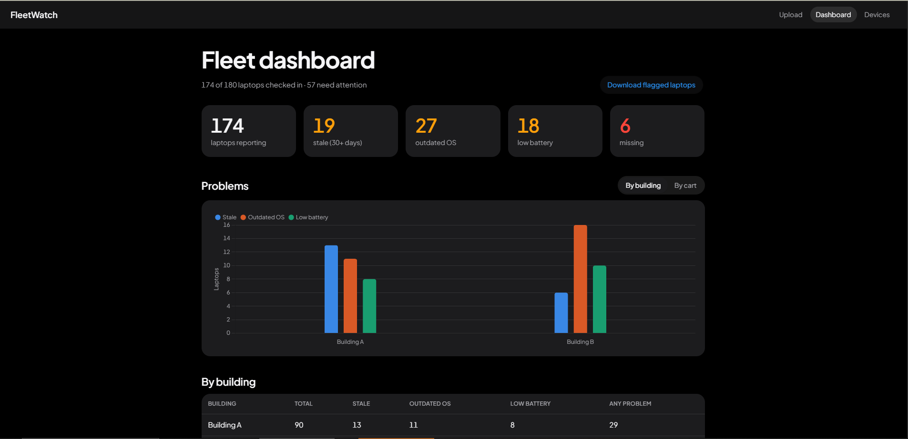
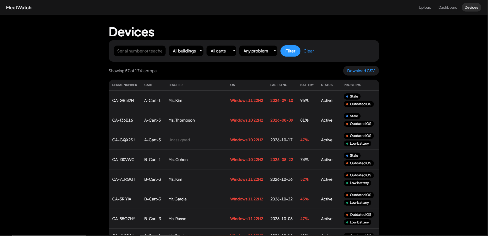

# FleetWatch
 
A web app that checks a school's laptop fleet for problems. Upload a device export and it flags laptops that stopped syncing, run an old OS, have a weak battery, or are missing, then shows it all on a dashboard by building and cart.
 
**Live demo:** https://andrescamargo.pythonanywhere.com (uses fake data, so feel free to click around)
 

 
## Why I built it
 
From September 2024 to January 2025 I was an IT intern at Children's Academy in New York, supporting about 180 laptops across 2 buildings and 6 carts of 30. I helped set up 90 of them for a new campus and handled around 15 tickets a day, sometimes for a whole cart at once.
 
To keep track of it all, I built a Google Sheet from Google Admin Console and Active Directory exports, logging each laptop's health and which teacher it belonged to. I updated it every week, and going through every cart in both buildings took most of the week. The hardest parts were spotting laptops that had quietly stopped syncing, and tracking down laptops that had ended up in a different teacher's classroom than the one they were assigned to.
 
 
FleetWatch is the tool I wish I'd had: upload the export, and stale, outdated, low-battery, and missing laptops are flagged in seconds instead of found row by row. Teacher assignments can be fixed right on the page and are kept from one export to the next.
 
## Features
 
- **Upload a device export** (CSV). The app checks that every required column is there before using it.
- **Automatic flags** for laptops that haven't synced in 30+ days, aren't on the current Windows version, or have battery health under 60%.
- **Missing laptops**: compares the export to the school's full inventory and lists laptops that never checked in.
- **Dashboard** with totals and per-building and per-cart breakdowns. Each number links to the matching laptops.
- **Device search** by serial number or teacher, with teacher-name suggestions as you type, and filters for building, cart, and problem type.
- **Teacher assignments** saved in a SQLite database, so they're kept when a new export is uploaded.
- **CSV download** of whatever is on screen, e.g. every flagged laptop to hand to the repair team.
- **Problems chart** by building or cart (Chart.js), and **problem badges** on every laptop.
- **20 automated tests** with pytest covering the flag rules, saving, uploading, and downloading.
- Dark mode and a phone layout.

 
## Tech stack
 
- **Python** with **pandas** for the analysis (`analysis.py`)
- **Flask** and **Jinja** templates for the website (`app.py`, `templates/`)
- **SQLite** for teacher assignments (`database.py`)
- **HTML and CSS** (no frameworks) for the design (`static/style.css`)
- **JavaScript** with **Chart.js** for the dashboard chart (`static/chart.js`)
- **pytest** for automated tests (`tests/`)
- Hosted on **PythonAnywhere**
All data is fake, made by `generate_data.py`. No real school or student data is used.
 
## Run it locally
 
```
git clone https://github.com/andrescamargo0/fleetwatch.git
cd fleetwatch
python -m venv .venv
.venv\Scripts\activate          # Mac/Linux: source .venv/bin/activate
pip install -r requirements.txt
python app.py
```
 
Then open http://127.0.0.1:5000. To make a fresh set of fake data, run `python generate_data.py`.
 
To run the tests:
 
```
python -m pytest
```
 
## What I'd add next
 
- A chart of fleet health over time, by saving each upload instead of replacing it
- Logins, so only IT staff can upload files or change assignments
- Pulling the export straight from Google Admin instead of uploading a CSV
 